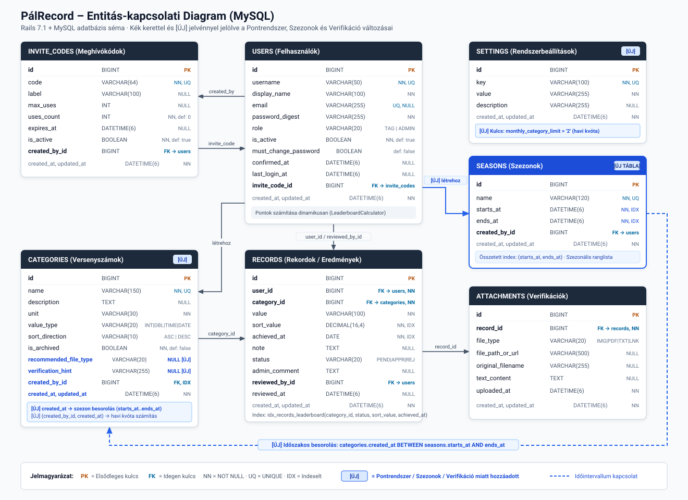
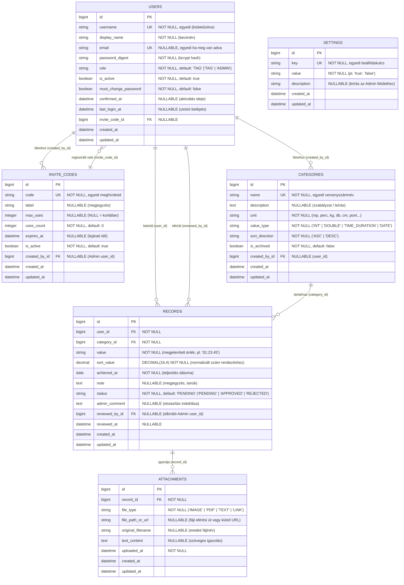

# PálRecord – Adatstruktúra Specifikáció (MySQL)

Ez a dokumentum a **PálRecord** alkalmazás véglegesített adatbázis-struktúráját és entitás-kapcsolati modelljét írja le **Rails 7.1 + MySQL (`mysql2`)** környezetre.

---

## 1. Entitás-kapcsolati Diagram (ERD)

Mermaid forráskód (szöveges definíció)

---

## 2. Táblák részletes specifikációja

### 2.1. `users` (Felhasználók)
A fiókkezelés központi táblája (Rails 7.1 `has_secure_password` + `generates_token_for` alapokon).

| Oszlop | MySQL típus | Kötelező? | Alapértelmezett | Index / Megjegyzés |
| :--- | :--- | :---: | :---: | :--- |
| `id` | `BIGINT AUTO_INCREMENT` | Igen (PK) | - | Elsődleges kulcs |
| `username` | `VARCHAR(50)` | Igen | - | **UNIQUE.** Belépési azonosító (trim + kisbetűs normalizálás). |
| `display_name` | `VARCHAR(100)` | Igen | - | Megjelenített név / becenév a ranglistákon. |
| `email` | `VARCHAR(255)` | Nem (`NULL`) | `NULL` | **UNIQUE.** MySQL-ben a `UNIQUE` index több `NULL` értéket is engedélyez. Csak akkor kötelező, ha `email_system = true`. |
| `password_digest` | `VARCHAR(255)` | Igen | - | `bcrypt` jelszó-hash. |
| `role` | `VARCHAR(20)` | Igen | `'TAG'` | `'TAG'` vagy `'ADMIN'`. |
| `is_active` | `BOOLEAN` | Igen | `true` | Ha `false`, a fiók fel van függesztve / tiltva. |
| `must_change_password` | `BOOLEAN` | Igen | `false` | `true` esetén a következő belépésnél kötelező a jelszócsere (admin ideiglenes jelszó esetén). |
| `confirmed_at` | `DATETIME(6)` | Nem | `NULL` | Fiók aktiválásának időpontja (`email_system = false` esetén regisztrációkor azonnal kitöltődik). |
| `last_login_at` | `DATETIME(6)` | Nem | `NULL` | Utolsó sikeres belépés időpontja. |
| `invite_code_id` | `BIGINT` (FK) | Nem | `NULL` | Hivatkozás az `invite_codes.id` mezőre (`ON DELETE SET NULL`). |
| `created_at`, `updated_at` | `DATETIME(6)` | Igen | - | Rails időbélyegek. |

---

### 2.2. `invite_codes` (Meghívókódok)
A zárt regisztráció biztosítására szolgáló tábla.

| Oszlop | MySQL típus | Kötelező? | Alapértelmezett | Index / Megjegyzés |
| :--- | :--- | :---: | :---: | :--- |
| `id` | `BIGINT AUTO_INCREMENT` | Igen (PK) | - | Elsődleges kulcs |
| `code` | `VARCHAR(64)` | Igen | - | **UNIQUE.** Meghívókód (pl. `PAL-8F3K9A`). |
| `label` | `VARCHAR(100)` | Nem | `NULL` | Adminisztrátori megjegyzés (pl. kinek készült). |
| `max_uses` | `INT` | Nem | `NULL` | Maximális felhasználások száma (`NULL` = korlátlan). |
| `uses_count` | `INT` | Igen | `0` | Eddigi sikeres regisztrációk száma a kóddal. |
| `expires_at` | `DATETIME(6)` | Nem | `NULL` | Opcionális lejárati időpont. |
| `is_active` | `BOOLEAN` | Igen | `true` | Kód aktív állapota. |
| `created_by_id` | `BIGINT` (FK → `users`) | Nem | `NULL` | Létrehozó Admin (`NULL` engedélyezett, ha seedből vagy törölt admintól származik). |
| `created_at`, `updated_at` | `DATETIME(6)` | Igen | - | Rails időbélyegek. |

---

### 2.3. `settings` (Rendszerbeállítások)
Adatbázisban tárolt, az Admin felületről futásidőben kapcsolható rendszerbeállítások.

| Oszlop | MySQL típus | Kötelező? | Alapértelmezett | Index / Megjegyzés |
| :--- | :--- | :---: | :---: | :--- |
| `id` | `BIGINT AUTO_INCREMENT` | Igen (PK) | - | Elsődleges kulcs |
| `key` | `VARCHAR(100)` | Igen | - | **UNIQUE.** Beállítás kulcsa. |
| `value` | `VARCHAR(255)` | Igen | - | Beállítás értéke (stringként tárolva, modellben konvertálva). |
| `description` | `VARCHAR(255)` | Nem | `NULL` | Emberi leírás az Admin felület számára. |
| `created_at`, `updated_at` | `DATETIME(6)` | Igen | - | Rails időbélyegek. |

**Alapértelmezett kulcsok (`db/seeds.rb`):**
- `email_system`: `'false'` — SMTP / e-mail megerősítés és önkiszolgáló jelszó-reset engedélyezése.
- `require_invite_code`: `'true'` — Regisztrációhoz kötelező-e meghívókód.
- `public_leaderboards`: `'true'` — Vendégek (nem belépve) láthatják-e a ranglistákat és verifikációkat.
- `members_can_create_categories`: `'false'` — Tagok létrehozhatnak-e új versenyszámot (egyébként csak Admin).
- `require_record_approval`: `'true'` — Beküldött rekordok előzetes admin jóváhagyásra várjanak-e (`PENDING`).

---

### 2.4. `categories` (Versenyszámok / Kategóriák)

| Oszlop | MySQL típus | Kötelező? | Alapértelmezett | Index / Megjegyzés |
| :--- | :--- | :---: | :---: | :--- |
| `id` | `BIGINT AUTO_INCREMENT` | Igen (PK) | - | Elsődleges kulcs |
| `name` | `VARCHAR(150)` | Igen | - | **UNIQUE.** Versenyszám neve. |
| `description` | `TEXT` | Nem | `NULL` | Szabályzat / érvényességi feltételek. |
| `unit` | `VARCHAR(30)` | Igen | - | Mértékegység (`mp`, `perc`, `kg`, `db`, `cm`, `pont`). |
| `value_type` | `VARCHAR(20)` | Igen | `'DOUBLE'` | Érték típusa és validációja: `'INT'`, `'DOUBLE'`, `'TIME_DURATION'`, `'DATE'`. |
| `sort_direction` | `VARCHAR(10)` | Igen | `'DESC'` | Rendezési irány: `'ASC'` (kisebb/korábbi jobb) vagy `'DESC'` (nagyobb/frissebb jobb). |
| `is_archived` | `BOOLEAN` | Igen | `false` | Archivált kategóriába új rekord nem küldhető be. |
| `created_by_id` | `BIGINT` (FK → `users`) | Nem | `NULL` | Létrehozó felhasználó. |
| `created_at`, `updated_at` | `DATETIME(6)` | Igen | - | Rails időbélyegek. |

---

### 2.5. `records` (Beküldött eredmények)

| Oszlop | MySQL típus | Kötelező? | Alapértelmezett | Index / Megjegyzés |
| :--- | :--- | :---: | :---: | :--- |
| `id` | `BIGINT AUTO_INCREMENT` | Igen (PK) | - | Elsődleges kulcs |
| `user_id` | `BIGINT` (FK → `users`) | Igen | - | Beküldő felhasználó. |
| `category_id` | `BIGINT` (FK → `categories`) | Igen | - | Versenyszám. |
| `value` | `VARCHAR(100)` | Igen | - | Megjelenített érték a kategória formátumában (pl. `"42"`, `"12.4"`, `"01:23.45"`). |
| `sort_value` | `DECIMAL(16, 4)` | Igen | - | Normalizált numerikus érték a pontos SQL rendezéshez (pl. időnél másodpercben). |
| `achieved_at` | `DATE` | Igen | - | Teljesítés dátuma (holtverseny esetén a korábbi áll előrébb). |
| `note` | `TEXT` | Nem | `NULL` | Körülmények, tanúk, megjegyzés. |
| `status` | `VARCHAR(20)` | Igen | `'PENDING'` | `'PENDING'`, `'APPROVED'`, `'REJECTED'`. |
| `admin_comment` | `TEXT` | Nem | `NULL` | Elutasítás indoklása / admin megjegyzés. |
| `reviewed_by_id` | `BIGINT` (FK → `users`) | Nem | `NULL` | Elbíráló Admin. |
| `reviewed_at` | `DATETIME(6)` | Nem | `NULL` | Elbírálás ideje. |
| `created_at`, `updated_at` | `DATETIME(6)` | Igen | - | Rails időbélyegek. |

**Ajánlott összetett index:** `INDEX idx_records_leaderboard (category_id, status, sort_value, achieved_at)`

---

### 2.6. `attachments` (Verifikációs anyagok)

| Oszlop | MySQL típus | Kötelező? | Alapértelmezett | Index / Megjegyzés |
| :--- | :--- | :---: | :---: | :--- |
| `id` | `BIGINT AUTO_INCREMENT` | Igen (PK) | - | Elsődleges kulcs |
| `record_id` | `BIGINT` (FK → `records`) | Igen | - | Kapcsolódó rekord (`ON DELETE CASCADE`). |
| `file_type` | `VARCHAR(20)` | Igen | - | `'IMAGE'`, `'PDF'`, `'TEXT'`, `'LINK'`. |
| `file_path_or_url` | `VARCHAR(500)` | Nem | `NULL` | Külső URL (`LINK`) vagy fájl elérési út. |
| `original_filename` | `VARCHAR(255)` | Nem | `NULL` | Feltöltött fájl eredeti neve. |
| `text_content` | `TEXT` | Nem | `NULL` | Szöveges igazolás (`TEXT`) tartalma. |
| `uploaded_at` | `DATETIME(6)` | Igen | `CURRENT_TIMESTAMP` | Feltöltés ideje. |
| `created_at`, `updated_at` | `DATETIME(6)` | Igen | - | Rails időbélyegek. |
