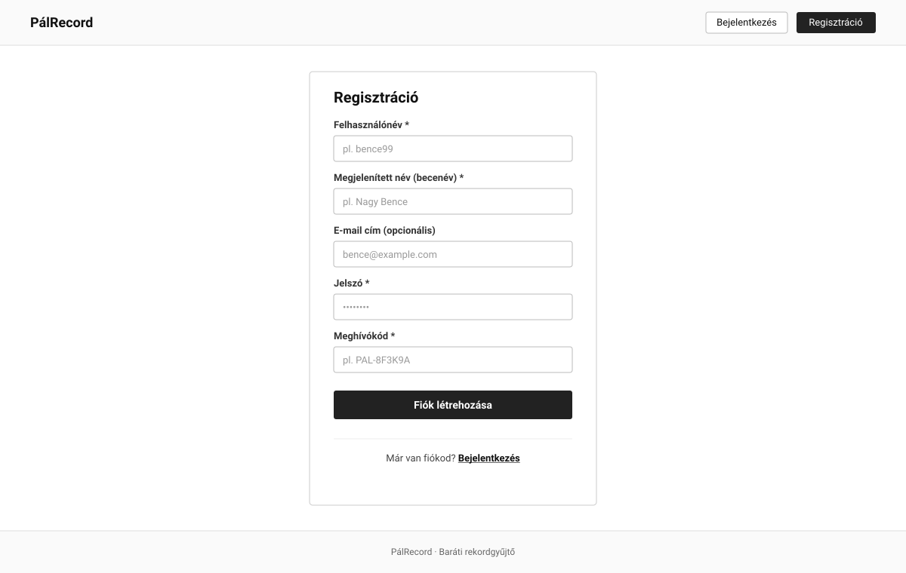

# PálRecord – Látványtervek és Minimalista CSS Irányelvek

Ez a dokumentum a **Kezdőlap**, a **Login** és a **Register** képernyők vizuális látványterveit, valamint a minimalista HTML/CSS felépítést rögzíti.

---

## Közös elrendezés (Application Layout)

Minden oldalon egy egyszerű, klasszikus fejléc–tartalom–lábléc (`flex-direction: column; min-height: 100vh`) szerkezet jelenik meg:

- **Fejléc (`<header>`):**
  - Bal oldalon: **PálRecord** logó / főoldal link.
  - Jobb sarokban:
    - Kijelentkezett állapotban: `Bejelentkezés` és `Regisztráció` gomb.
    - Bejelentkezett állapotban: `Kijelentkezés` gomb (opcionálisan a felhasználó nevével / profil linkkel).
- **Lábléc (`<footer>`):**
  - Egyszerű alsó sáv (`PálRecord · Baráti rekordgyűjtő`).
- **Stílus:** Rendszer-betűtípus (`system-ui, sans-serif`), fehér háttér (`#ffffff`), vékony szürke keretek (`1px solid #cccccc` / `#dddddd`), sötétszürke gombok (`#222222`), felesleges árnyékok, animációk és CSS keretrendszerek nélkül.

---

## 1. Kezdőlap (Kategóriák listája)

- Két oldalon margó (`max-width: 800px; margin: 0 auto; padding: 24px 16px;`).
- Középen egy letisztult lista/táblázat a kategóriákról, az alábbi adatokkal:
  1. **Kategória neve** (link a kategória ranglistájára)
  2. **`sort_by` típusa** (pl. `TIME_DURATION · ASC`, `DOUBLE · DESC`, `INT · DESC`)
  3. **Top 1 eredmény** (rekorder neve + elért értéke, vagy *"Még nincs elfogadott rekord"*)

---

## 2. Login oldal (Bejelentkezés)

- Középre igazított négyzet/doboz (`max-width: 380px; margin: auto; border: 1px solid #ccc; padding: 24px;`).
- Mezők: `Felhasználónév vagy e-mail`, `Jelszó`, `Belépés` gomb.
- A négyzet alján átváltási link a **Regisztráció** oldalra (`Még nincs fiókod? Regisztráció`).

---

## 3. Register oldal (Regisztráció)

- Középre igazított négyzet/doboz, azonos arányokkal és stílussal.
- Mezők: `Felhasználónév`, `Megjelenített név (becenév)`, `E-mail cím` (opcionális vagy kötelező az `email_system` beállításától függően), `Jelszó`, `Meghívókód` (ha a `require_invite_code` aktív).
- A négyzet alján átváltási link a **Bejelentkezés** oldalra (`Már van fiókod? Bejelentkezés`).

