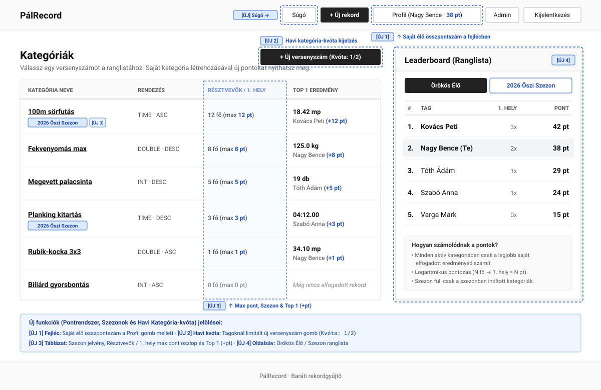
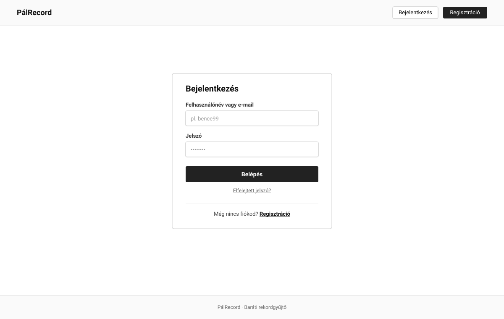

# PálRecord – Látványtervek és Minimalista CSS Irányelvek

Ez a dokumentum a **Kezdőlap**, a **Login**, a **Register** és a pontrendszerrel kibővített nézetek vizuális látványterveit, valamint a minimalista HTML/CSS felépítést rögzíti.

> [!IMPORTANT]
> **🆕 Új funkciók miatti UI-változások (Pontrendszer, Szezonok és Havi Kategóriakvóta):**
> A dokumentumban és a frissített [kezdolap.svg](kezdolap.svg) rajzon `[ÚJ]` / `🆕 [ÚJ – Pontrendszer]` jelöléssel látható minden változtatás:
> - **`[ÚJ 1]` Fejléc pontjelző:** Saját élő összpontszám megjelenítése (`Profil (Név · XX pt)`).
> - **`[ÚJ 2]` Havi kategórialétrehozási kvóta:** Tagok számára az `+ Új versenyszám (Kvóta: X/Y)` gomb kijelzése.
> - **`[ÚJ 3]` Kategóriatábla bővítése:** Szezonális jelvény, `Résztvevők / 1. hely` max pont oszlop és Top 1 rekorder pontszáma (`+X pt`).
> - **`[ÚJ 4]` Leaderboard oldalsáv:** Kétoszlopos elrendezés jobb oldalon `Örökös Élő` és szezonális ranglistákkal.
> - **Részletes kategória- és profilnézet (`4.` fejezet):** Helyezési pont oszlop, szezonok és holtversenyek vizuális terve.

---

## Közös elrendezés (Application Layout)

Minden oldalon egy egyszerű, klasszikus fejléc–tartalom–lábléc (`flex-direction: column; min-height: 100vh`) szerkezet jelenik meg:

- **Fejléc (`<header>`):**
  - Bal oldalon: **PálRecord** logó / főoldal link.
  - Jobb sarokban:
    - Kijelentkezett állapotban: `Bejelentkezés` és `Regisztráció` gomb.
    - Bejelentkezett állapotban: `+ Új rekord`, 🆕 **`[ÚJ 1 – Pontrendszer]`** `Profil (Név · XX pt)` (saját élő összpontszám kijelzésével), admin jogosultság esetén `Admin`, valamint `Kijelentkezés` gomb.
- **Lábléc (`<footer>`):**
  - Egyszerű alsó sáv (`PálRecord · Baráti rekordgyűjtő`).
- **Stílus:** Rendszer-betűtípus (`system-ui, sans-serif`), fehér háttér (`#ffffff`), vékony szürke keretek (`1px solid #cccccc` / `#dddddd`), sötétszürke gombok (`#222222`), felesleges árnyékok, animációk és CSS keretrendszerek nélkül.

---

## 1. Kezdőlap (Kategóriák listája és Leaderboard)

- 🆕 **`[ÚJ 4 – Pontrendszer]` Kétoszlopos elrendezés (`.home-layout`):** Szélesebb központi konténer (`max-width: 1120px; margin: 0 auto; padding: 24px 16px;`), bal oldalon a kategóriák listájával (`.home-main`), jobb oldalon a ranglista oldalsávval (`.home-sidebar`, mobilon egymás alá törve).
- **Bal oldali fő oszlop (`.home-main`):**
  - Fejléc sáv a `+ Új versenyszám` gombbal: 🆕 **`[ÚJ 2 – Pontrendszer]`** Tagoknál jelenik meg a havi keret (`Kvóta: 1/2`), amelyet a `monthly_category_limit` beállítás vezérel (ha elérte a limitet, letiltva/tájékoztatóval látható).
  - Középen letisztult táblázat a kategóriákról, az alábbi adatokkal:
    1. **Kategória neve** (link a kategória ranglistájára) + 🆕 **`[ÚJ 3 – Pontrendszer]`** aktuális szezon jelvény (pl. `2026 Őszi Szezon`), ha a kategória létrehozási ideje beleesik egy szezon időszakába.
    2. **`sort_by` / Rendezés típusa** (pl. `TIME_DURATION · ASC`, `DOUBLE · DESC`, `INT · DESC`)
    3. 🆕 **`[ÚJ 3 – Pontrendszer]` Résztvevők / 1. hely:** Aktív jóváhagyott résztvevők száma és az 1. helyért járó maximális pont (`N fő (max N pt)`).
    4. **Top 1 eredmény** (rekorder neve + elért értéke + 🆕 **`[ÚJ 3 – Pontrendszer]`** megszerezhető helyezési pont `(+N pt)`, vagy *"Még nincs elfogadott rekord"*).
- 🆕 **`[ÚJ 4 – Pontrendszer]` Jobb oldali Leaderboard kártya (`.home-sidebar`):**
  - Váltófülek: **`Örökös Élő`** és a definiált **Szezonok** (pl. `2026 Őszi Szezon`).
  - Ranglista táblázat: `#` (helyezés), `TAG` (bejelentkezett felhasználó kiemelve), `1. HELY` (elsőségek száma), `PONT` (logaritmikus képlet alapján összesített pontszám).
  - Rövid magyarázó doboz a pontszámítás és a szezonális szűrés szabályairól.

---

## 2. Login oldal (Bejelentkezés)

- Középre igazított négyzet/doboz (`max-width: 380px; margin: auto; border: 1px solid #ccc; padding: 24px;`).
- Mezők: `Felhasználónév vagy e-mail`, `Jelszó`, `Belépés` gomb.
- A négyzet alján átváltási link a **Regisztráció** oldalra (`Még nincs fiókod? Regisztráció`).

---

## 3. Register oldal (Regisztráció)

- Középre igazított négyzet/doboz, azonos arányokkal és stílussal.
- Mezők: `Felhasználónév`, `Megjelenített név (becenév)`, `E-mail cím` (opcionális vagy kötelező az `email_system` beállításától függően), `Jelszó`, `Meghívókód` (ha a `require_invite_code` aktív).
- A négyzet alján átváltási link a **Bejelentkezés** oldalra (`Már van fiókod? Bejelentkezés`).

---

## 4. Pontrendszer és Szezonok részletes nézetei — 🆕 [ÚJ FUNKCIÓ]

A pontrendszerhez kapcsolódó további képernyőelemek és nézetek (a központi minimalista stílust követve):

- **Kategória ranglista nézet (`categories#show`):**
  - Fejlécben az aktuális résztvevők száma (`N fő`) és az 1. helyért járó maximális pont, valamint szezonális badge, ha a kategória szezonba esik.
  - A táblázatban új **`Helyezési pont`** oszlop: minden felhasználónál csak a legjobb elfogadott rekordja kap logaritmikus pontot, a többi saját kísérlet `0 pt` jelöléssel szerepel; holtverseny esetén azonos `sort_value`-nál a korábban beküldött (`created_at ASC`) rekord áll előrébb.
- **Felhasználói profil nézet (`profiles#show`):**
  - Összegzett pontkártyák (`Örökös összpontszám`, `Aktív helyezések`, `1. helyezések`, valamint szezononkénti pontbontás).
  - Havi kategórialétrehozási kvóta állapota és elért helyezések kategóriánként.
- **Admin felület:**
  - **Szezonok kezelése (`admin/seasons`):** Új szezon létrehozása (`name`, `starts_at`, `ends_at`), szerkesztése és törlése.
  - **Rendszerbeállítások (`admin/settings`):** `monthly_category_limit` paraméter állítása (`0` = korlátozva/tiltva, alapérték `'2'`).

> További részletek és a teljes logaritmikus pontozási specifikáció: [Pontrendszer specifikáció](../Új%20Funkciók/Pontrendszer/pontrendszer.md)
