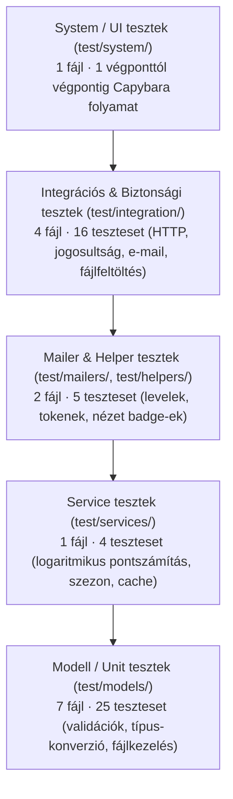

# PálRecord – Teljes Projektet Lefedő Tesztelési Specifikáció és Katalógus

Ez a dokumentum a **PálRecord** alkalmazás teljes tesztkészletét foglalja össze **teszttípus szerint rendezve**, megkülönböztetve a korábban elkészült alapteszteket és az alkalmazás teljes lefedettségéhez hozzáadott új teszteket.

---

## 1. Tesztpiramis és Lefedettségi Áttekintés



| Teszttípus | Fájlok száma | Tesztesetek száma | Fő cél |
| :--- | :---: | :---: | :--- |
| **1. Modell / Unit tesztek** (`test/models/`) | 7 | 25 | Validációk, normalizálás, konverziók, fájlkezelés, kapcsolatok |
| **2. Service tesztek** (`test/services/`) | 1 | 4 | Logaritmikus pontszámítás, holtversenyek, szezonok, cache |
| **3. Mailer tesztek** (`test/mailers/`) | 1 | 2 | Aktiváló és jelszó-visszaállító e-mailek, tokenek |
| **4. Helper tesztek** (`test/helpers/`) | 1 | 3 | Státusz- és pont-jelvények, értékformátum-súgók |
| **5. Integrációs tesztek** (`test/integration/`) | 5 | 17 | Teljes HTTP folyamatok, admin/tag jogosultságok, biztonság |
| **6. System / UI tesztek** (`test/system/`) | 1 | 1 | Valós DOM-űrlapok és gombok végigkattintása (`:rack_test`) |
| **Összesen** | **16** *(+1 csatorna váz)* | **52** | Teljes stack lefedettsége modelltől a böngésző-nézetekig |

---

## 2. Tesztesetek részletes katalógusa (Típus szerint)

### 2.1. Modell / Unit tesztek (`test/models/`)

#### A) `test/models/user_test.rb` (`UserTest` – 5 teszt)
- *(Meglévő)* `normalizes username and blank email to nil`: Felhasználónév kisbetűsítése/trimmelése és üres e-mail `nil`-re alakítása.
- *(Meglévő)* `authenticates by username or email`: Beléptetés felhasználónévvel vagy e-maillel (`authenticate_by_login`), hibás jelszó elutasítása.
- *(Meglévő)* `requires email when email_system setting is true`: E-mail kötelezősége bekapcsolt `email_system` esetén.
- *(Új)* `identifies last_active_admin? accurately`: Egyedüli aktív admin felismerése (inaktív adminok és több admin jelenlétének helyes kezelése).
- *(Új)* `generates and invalidates email_confirmation and password_reset tokens`: Token-generálás és automatikus érvénytelenedés e-mail/jelszó módosítása után.

#### B) `test/models/record_test.rb` (`RecordTest` – 4 teszt)
- *(Meglévő)* `computes sort_value for INT, DOUBLE, TIME_DURATION, and DATE categories`: `sort_value` kiszámítása mind a 4 adattípusra (tizedesvessző, `óó:pp:mp.század` és dátum).
- *(Meglévő)* `rejects invalid values and archived categories`: Hibás időformátum és archivált kategória elutasítása.
- *(Meglévő)* `orders approved records by sort_direction, breaks ties by earlier created_at, and excludes inactive users`: `ASC` rendezés, holtverseny feloldása `created_at` alapján, `PENDING` és inaktív felhasználók kiszűrése.
- *(Új)* `rejects decimals for INT and impossible calendar dates for DATE, and orders DESC categories highest-first`: Egész szám típusnál tört érték elutasítása, lehetetlen dátum (`2026-02-30`) elutasítása és `DESC` irányú kategória csökkenő sorrendje.

#### C) `test/models/season_test.rb` (`SeasonTest` – 2 teszt)
- *(Meglévő)* `validates name, dates, and ends_at after starts_at`: Szezon név-egyediség és érvényes időintervallum ellenőrzése.
- *(Meglévő)* `determines active status and matches active categories created within range`: `Lezárt` / `Aktív` / `Közelgő` címkék, valamint a szezon időszakába eső aktív kategóriák párosítása.

#### D) `test/models/setting_test.rb` (`SettingTest` – 3 új teszt)
- `ensure_defaults! creates all expected settings with defaults`: Mind a 6 alapértelmezett rendszerkulcs létrehozása és kezdőértékei.
- `get, set, and get_bool update and read settings`: Beállítások írása, olvasása és logikai kiértékelése.
- `monthly_category_limit handles valid integers and falls back to 2 on invalid values`: Pozitív/nulla kvóta kezelése, hibás vagy negatív értéknél fallback `2`-re.

#### E) `test/models/invite_code_test.rb` (`InviteCodeTest` – 3 új teszt)
- `generates code automatically when blank and normalizes provided code`: Automatikus `PAL-XXXXXX` kódgenerálás és nagybetűs normalizálás.
- `evaluates expired?, exhausted?, usable?, and usage_summary`: Lejárt, kimerült, inaktív, korlátos és korlátlan (`∞`) kódok ellenőrzése.
- `nullifies user invite_code_id on destroy without deleting the user`: Meghívókód törlésekor a felhasználó megmarad, az `invite_code_id` `nil` lesz.

#### F) `test/models/category_test.rb` (`CategoryTest` – 4 új teszt)
- `normalizes name and unit and enforces case-insensitive uniqueness`: Név és mértékegység tisztítása, kis/nagybetű-független egyediség.
- `rejects invalid value_type and sort_direction`: Érvénytelen típus és rendezési irány elutasítása.
- `formats display_record_value properly across types and units`: Különleges formázások (`TIME_DURATION`, `-` mértékegység, normál mértékegység).
- `destroys associated records when category is destroyed`: Kategória törlésekor a rekordok kaszkádolt törlése.

#### G) `test/models/attachment_test.rb` (`AttachmentTest` + `AttachmentCleanupCommitTest` – 4 új teszt)
- `validates TEXT and LINK payloads strictly`: Szöveges igazolás kötelezősége, valamint `javascript:` és hibás URL-ek elutasítása (`http://` / `https://` kényszer).
- `validates IMAGE and PDF extensions and max file size`: Kiterjesztés-ellenőrzés (`.exe`, kereszt-típus elutasítása) és `10 MB`-os méretkorlát.
- `persists uploaded IMAGE and PDF files into test storage_root`: Valódi képfájl és PDF mentése a teszt tárhelyre (`tmp/storage/uploads`).
- `cleanup_stored_file removes physical file on destroy commit`: Tranzakciós commit után a fizikai fájl törlődik a lemezről `destroy!` híváskor.

---

### 2.2. Service / Üzleti logika tesztek (`test/services/`)

#### `test/services/leaderboard_calculator_test.rb` (`LeaderboardCalculatorTest` – 4 teszt)
- *(Meglévő)* `computes logarithmic placement points accurately`: A logaritmikus pontképlet ellenőrzése `N = 1, 2, 3, 5, 8, 12` főre (beleértve `N=12 → [12, 8, 6, 5, 4, 3, 3, 2, 2, 1, 1, 1]`).
- *(Meglévő)* `counts only personal best per user, breaks ties by created_at, and ignores inactive users`: Személyes legjobb szűrése, gyengébb saját kísérlet `0 pt`, holtverseny-feloldás, inaktív tagok kizárása.
- *(Meglévő)* `computes overall and seasonal leaderboards, tie-breakers, and excludes archived categories`: Örökös és szezonális ranglisták összehasonlítása, archivált kategória `0 pt`.
- *(Meglévő)* `uses first_places_count and categories_count as overall tie-breakers and invalidates cache on changes`: Összetett holtverseny (1. helyek száma) és `MemoryStore` cache-invalidáció ellenőrzése.

---

### 2.3. Mailer tesztek (`test/mailers/`)

#### `test/mailers/user_mailer_test.rb` (`UserMailerTest` – 2 új teszt)
- `email_confirmation sends confirmation link with valid token`: Megerősítő e-mail címzettje, tárgya, HTML/szöveges tartalma és a benne szereplő `:email_confirmation` token érvényessége.
- `password_reset sends reset link with valid token`: Jelszó-visszaállító e-mail címzettje, tárgya, HTML/szöveges tartalma és `:password_reset` token érvényessége.

---

### 2.4. Helper tesztek (`test/helpers/`)

#### `test/helpers/application_helper_test.rb` (`ApplicationHelperTest` – 3 új teszt)
- `status_badge renders Hungarian labels and status classes`: `PENDING`, `APPROVED`, `REJECTED` magyar címkék és CSS osztályok.
- `points_badge highlights first place, standard placements, and archived categories`: 1. helyezett, normál helyezés és archivált `0 pt` badge.
- `value_type_hint returns hints for all supported category value types`: Szelektív súgószövegek az összes adattípushoz.

---

### 2.5. Integrációs és Biztonsági tesztek (`test/integration/`)

#### A) `test/integration/authentication_flow_test.rb` (`AuthenticationFlowTest` – 4 teszt)
- *(Meglévő)* `registration requires valid invite code when enabled and increments uses_count`: Meghívókódos regisztráció és felhasználási számláló növelése.
- *(Meglévő)* `public_leaderboards setting controls guest access to homepage`: Vendégek beléptetési kényszere zárt módnál.
- *(Meglévő)* `member submits pending record and admin approves it`: Rekord beküldése (`PENDING`) és admin jóváhagyás (`APPROVED`).
- *(Meglévő)* `must_change_password forces redirect to profile until updated`: Ideiglenes jelszó utáni kötelező jelszócsere kikényszerítése.

#### B) `test/integration/points_and_seasons_flow_test.rb` (`PointsAndSeasonsFlowTest` – 3 teszt)
- *(Meglévő)* `homepage, category page, and profile display points, ties, secondary attempts, and seasons`: Kezdőlap fejléc/oldalsáv, kategória ranglista és profil összesítő kártyák ellenőrzése.
- *(Meglévő)* `enforces monthly category quota for TAG users while exempting ADMIN and past-month categories`: Havi kvóta (`2/hó`) betartatása és dinamikus módosítása.
- *(Meglévő)* `admin can create, edit, and delete seasons`: Admin szezonkezelés teljes CRUD folyamata.

#### C) `test/integration/security_and_authorization_test.rb` (`SecurityAndAuthorizationTest` – 5 új teszt)
- `guests and TAG users are blocked from all admin endpoints`: Vendég és `TAG` szerepkör blokkolása az összes `/admin/*` végponton (`admin/categories` POST/PATCH/DELETE végpontokat is beleértve) és kategória-szerkesztésen.
- `TAG can edit and destroy own PENDING record only, not APPROVED or others records`: Csak a saját függőben lévő rekord módosítható/törölhető; jóváhagyott vagy más felhasználó rekordja védett.
- `protects last active admin and allows admin to reset password or suspend other users`: Az utolsó aktív Admin önvédelme (lefokozás, tiltás, törlés tiltva), valamint ideiglenes jelszó-generálás és tag felfüggesztése.
- `suspended user cannot log in and active session is invalidated upon suspension`: Felfüggesztett felhasználó azonnali kizárása aktív munkamenetből és belépéskor.
- `attachments controller enforces visibility rules for pending and private records`: `PENDING` csatolmány csak a tulajdonosnak és Adminnak elérhető; `public_leaderboards = false` esetén Vendég a jóváhagyott mellékletet sem töltheti le.

#### D) `test/integration/email_system_and_attachments_flow_test.rb` (`EmailSystemAndAttachmentsFlowTest` – 4 új teszt)
- `email_system=true requires email confirmation before login`: E-mail aktiválási lánc (`register` → blokkolt login → `/email_confirmation` → sikeres login).
- `email_system=true allows self-service password reset and invalidates used token`: Teljes önkiszolgáló jelszó-visszaállítási folyamat és felhasznált token érvénytelenítése.
- `email_system=false blocks password reset POST requests`: Kikapcsolt e-mail rendszer esetén a jelszó-reset POST kérés elutasítása.
- `require_record_approval=false immediately approves submitted record with file attachment`: Azonnali rekord-jóváhagyás képmelléklettel és annak letöltése (`/attachments/:id`).

#### E) `test/integration/admin_categories_flow_test.rb` (`AdminCategoriesFlowTest` – 1 új teszt)
- `admin can view, filter, create, edit, archive, restore, and delete categories`: A teljes `/admin/categories` adminisztrációs életciklus (szűrés `ALL`/`ACTIVE`/`ARCHIVED` alapján, új kategória felvétele és hibakezelés `422`, szerkesztés, egykattintásos archiválás/visszaállítás, valamint törlés a kapcsolódó rekordokkal együtt).

---

### 2.6. System / UI folyamattesztek (`test/system/`)

#### `test/system/user_journey_system_test.rb` (`UserJourneySystemTest` – 1 új teszt)
- *(Konfiguráció)* `test/application_system_test_case.rb` `:rack_test` meghajtóra állítva (külső böngészőfüggőség nélkül futtatható).
- `full user UI journey: register, submit record, admin approves, and leaderboard updates`: Teljes felhasználói folyamat UI elemeken keresztül (regisztráció űrlap → fejléc pontkijelzés → új rekord + szöveges melléklet beküldése → kijelentkezés → admin belépés és jóváhagyás → kezdőlap és kategória oldal pontjainak ellenőrzése).

---

## 3. Futtatási parancsok (Célkörnyezetben)

Az összes teszt futtatása:
```bash
bin/rails test
```

System (UI) tesztek külön futtatása:
```bash
bin/rails test:system
```

Típusonkénti futtatás:
```bash
bin/rails test test/models/
bin/rails test test/services/
bin/rails test test/mailers/
bin/rails test test/helpers/
bin/rails test test/integration/
```
