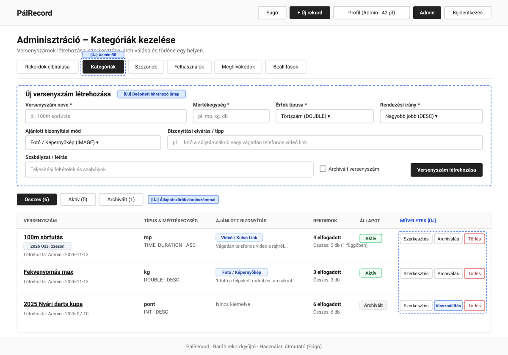

# PálRecord – Admin Kategóriakezelő Felület (`/admin/categories`) Specifikáció

Ez a dokumentum a **PálRecord** alkalmazás új, központi **Admin – Kategóriák (`/admin/categories`)** felületének funkcionális, biztonsági és vizuális specifikációját írja le.

Kapcsolódó dokumentumok:
- [Adatstruktúra specifikáció](../../Adatstruktúra/adatstruktura.md)
- [Alap látványtervek](../../Látványtervek/latvanyterv.md)
- [Pontrendszer specifikáció](../Pontrendszer/pontrendszer.md)
- [Verifikációs specifikáció](../Verifikáció/verifikacio.md)

---

## 1. Célkitűzés és alapelvek

Korábban az adminisztrátorok csak a nyilvános kategóriaoldalon keresztül tudtak kategóriát létrehozni vagy egyenként szerkeszteni; az archivált kategóriák gyors szűrése, egykattintásos archiválása/visszaállítása és végleges törlése nem volt központosítva az adminisztrációs felületen.

Az új **Admin – Kategóriák** felület alapelvei:
1. **Egységes adminisztrációs élmény:** A többi admin menüponthoz (`Rekordok elbírálása`, `Szezonok`, `Felhasználók`, `Meghívókódok`, `Beállítások`) illeszkedő, letisztult elrendezés (`admin/_nav.html.erb`).
2. **Azonnali kategória-létrehozás:** A `Szezonok` felület mintájára az oldal tetején beépített kártya kínálja az új versenyszám felvételét az összes metaadattal (név, mértékegység, értéktípus, rendezési irány, ajánlott bizonyítási mód, bizonyítási tipp, szabályzat, archivált állapot).
3. **Állapotszűrő és gyorsműveletek:** `Összes`, `Aktív` és `Archivált` szűrőfülek pontos darabszámokkal; a táblázatban 1 kattintásos **Archiválás / Visszaállítás**, dedikált **Szerkesztés** nézet és megerősített végleges **Törlés** (amely a rekordokat és a kapcsolódó mellékleteket is törli).
4. **Automatikus ranglista-szinkron:** Mivel a `Category` modell tartalmazza a `LeaderboardCacheInvalidatable` concern-t, minden létrehozás, archiválás, visszaállítás, módosítás és törlés automatikusan érvényteleníti a `LeaderboardCalculator` gyorsítótárát.

---

## 2. Látványterv

---

## 3. Útvonalak és jogosultságok

| HTTP művelet | Útvonal | Controller akció | Jogosultság |
| :--- | :--- | :--- | :--- |
| `GET` | `/admin/categories` | `Admin::CategoriesController#index` | Csak `ADMIN` (`BaseController#require_admin`) |
| `POST` | `/admin/categories` | `Admin::CategoriesController#create` | Csak `ADMIN` (adminokra a `monthly_category_limit` nem vonatkozik) |
| `GET` | `/admin/categories/:id/edit` | `Admin::CategoriesController#edit` | Csak `ADMIN` |
| `PATCH / PUT` | `/admin/categories/:id` | `Admin::CategoriesController#update` | Csak `ADMIN` (adatok módosítása vagy gyors `is_archived` váltás) |
| `DELETE` | `/admin/categories/:id` | `Admin::CategoriesController#destroy` | Csak `ADMIN` (törli a kategóriát és kaszkádolva a rekordjait/mellékleteit) |

- Vendég (`!logged_in?`) esetén minden végpont a `/login` oldalra irányít át.
- Normál tag (`TAG`) esetén minden végpont a főoldalra irányít át figyelmeztető üzenettel.

---

## 4. Képernyőelemek és viselkedés

### 4.1. Szűrősáv (`status` query paraméter)
- **`Összes (N)`** (`status=ALL`, alapértelmezett): Minden aktív és archivált versenyszám (`ordered` scope: először az aktívak, majd az archiváltak névsorrendben).
- **`Aktív (N)`** (`status=ACTIVE`): Kizárólag a `Category.active` (`is_archived = false`) rekordok.
- **`Archivált (N)`** (`status=ARCHIVED`): Kizárólag a `Category.archived` (`is_archived = true`) rekordok.
- A szerkesztés, archiválás, visszaállítás és törlés műveletek megőrzik a `return_status` paramétert, így az admin ugyanarra a szűrt nézetre kerül vissza.

### 4.2. Táblázat oszlopai
1. **Versenyszám:** Kattintható link a kategória nyilvános oldalára (`category_path`), aktuális szezon jelvény (`matching_season`), rövidített szabályzat és a létrehozó felhasználó + létrehozási dátum.
2. **Típus & Mértékegység:** Mértékegység (`unit`) és `sort_by_label` (pl. `TIME_DURATION · ASC`).
3. **Ajánlott bizonyítás:** A `recommended_proof_badge` jelvény és a `verification_hint` rövidített szövege.
4. **Rekordok:** Elfogadott rekordok száma, összes beküldött rekord száma és esetleges függőben lévő (`PENDING`) rekordok darabszáma.
5. **Állapot:** `Aktív` (`badge-approved`) vagy `Archivált` (`badge-muted`) jelvény.
6. **Műveletek:**
   - **Szerkesztés:** Megnyitja az `/admin/categories/:id/edit` oldalt.
   - **Archiválás / Visszaállítás:** `PATCH /admin/categories/:id` hívással egy kattintással átkapcsolja az `is_archived` állapotot. Archivált kategóriába új rekord nem küldhető be, és pontjai kikerülnek a ranglistából.
   - **Törlés:** `DELETE /admin/categories/:id` megerősítő párbeszédablakkal (`turbo_confirm`), amely kiírja a törlendő rekordok darabszámát is.

---

## 5. Érintett kód- és dokumentációs fájlok

- `app/models/category.rb` (`archived` scope)
- `config/routes.rb` (`namespace :admin` → `resources :categories`)
- `app/controllers/admin/categories_controller.rb`
- `app/views/admin/_nav.html.erb` (`Kategóriák` fül)
- `app/views/admin/categories/_form.html.erb`
- `app/views/admin/categories/index.html.erb`
- `app/views/admin/categories/edit.html.erb`
- `app/views/categories/show.html.erb` (admin szerkesztés link)
- `test/integration/admin_categories_flow_test.rb` és `test/integration/security_and_authorization_test.rb`
