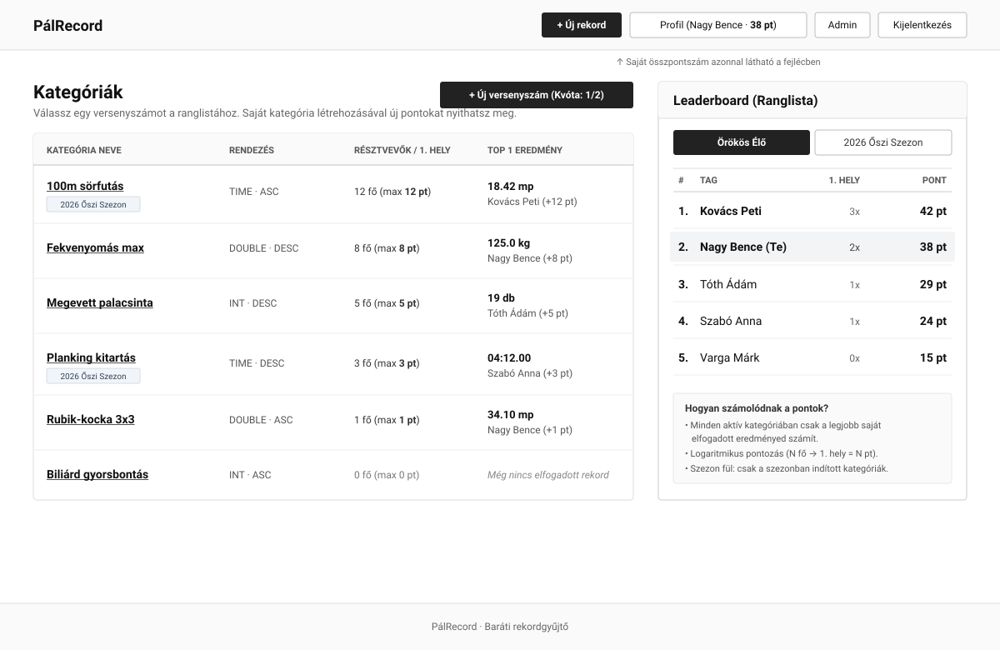
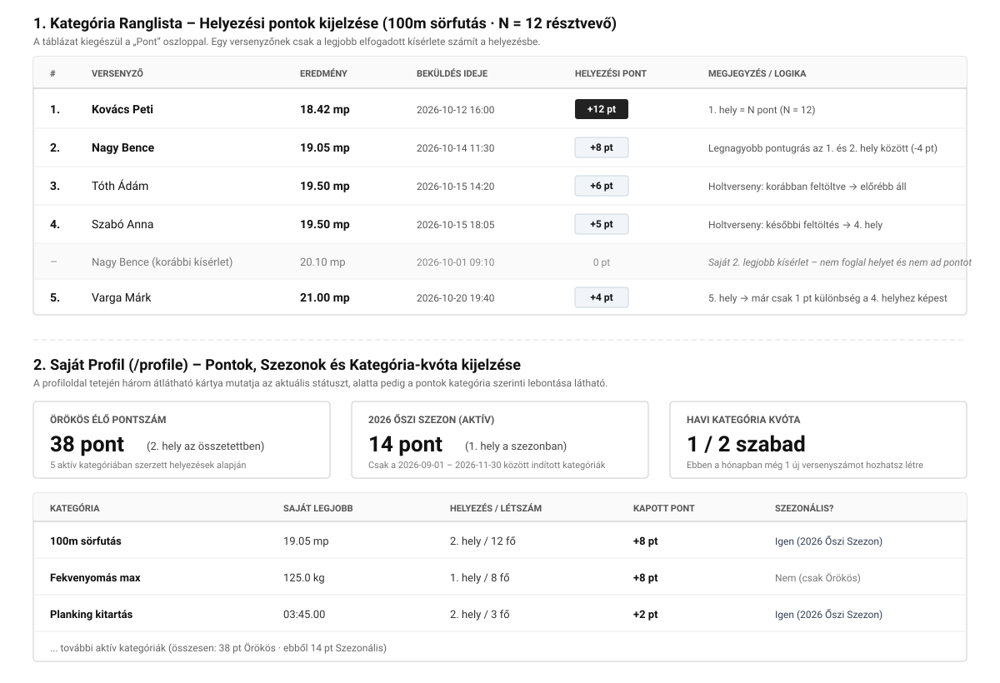
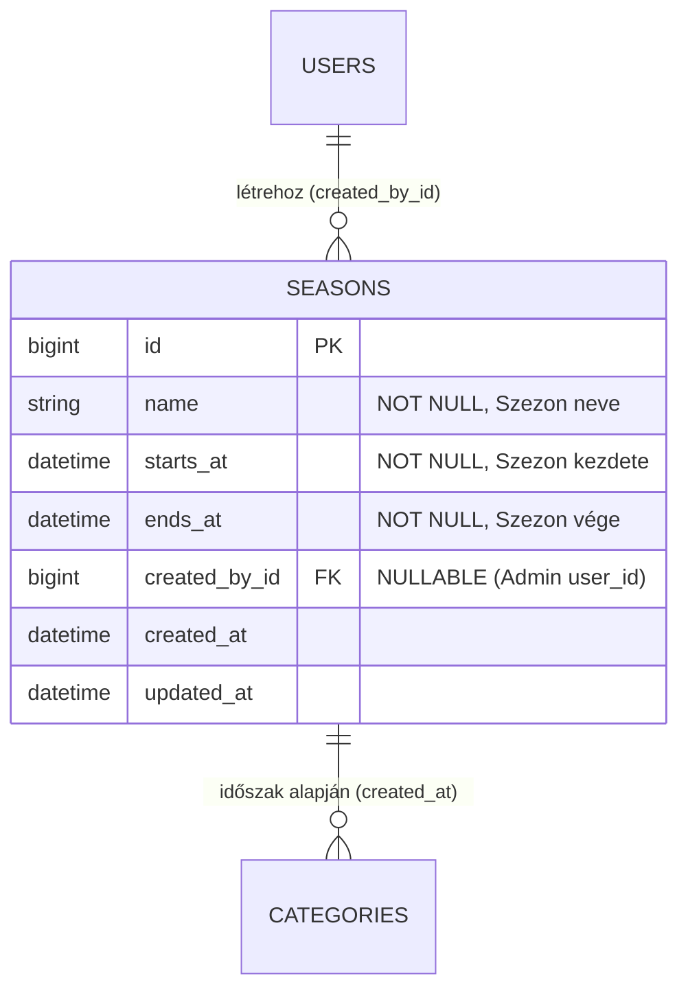

# PálRecord – Pontrendszer Specifikáció

Ez a dokumentum a **PálRecord** alkalmazás közösségi pontrendszerének, összesített ranglistájának (Leaderboard), szezonális versenyeinek és kategória-létrehozási kvótájának funkcionális, matematikai és vizuális specifikációját rögzíti.

Kapcsolódó dokumentumok:
- [Adatstruktúra specifikáció](../../Adatstruktúra/adatstruktura.md)
- [Fiókkezelési rendszer specifikáció](../../Fiókkezelés/fiokkezeles.md)
- [Alap látványtervek](../../Látványtervek/latvanyterv.md)

---

## 1. Célkitűzés és alapelvek

A pontrendszer célja a baráti társaság **aktivitásra ösztönzése** úgy, hogy közben elkerülje a spammelést, az egyenetlen aktivitásból fakadó irreális pontkülönbségeket és az üres kategóriákkal való pontgyűjtést:

1. **Csak helyezési pontok:** Nem a beküldések darabszáma ad pontot, hanem az aktuálisan elfoglalt helyezések a kategóriákban. Egy felhasználónak egy kategórián belül **kizárólag a legjobb 1 elfogadott (`APPROVED`) eredménye** számít.
2. **Résztvevő-arányos érték:** Minél többen indulnak egy kategóriában, annál több pontot ér a megnyerése. Egy 1 fős kategória 1 pontot ér, egy 12 fős kategória megnyerése 12 pontot.
3. **Logaritmikus csökkenés:** Az 1. és 2. helyezett között van a legnagyobb pontkülönbség, majd a helyezések romlásával egyre kisebbek az ugrások. Ez erősen ösztönzi a rekorddöntést és az 1. hely megszerzését.
4. **Saját kategóriák, korlátozott kvótával:** A tagok hozhatnak létre új versenyszámokat (amiben jók szeretnének lenni), de havi kvótával korlátozva, hogy a piac ne telítődjön felesleges kategóriákkal.

---

## 2. Logaritmikus pontszámítási képlet

Ha egy aktív kategóriában **`N`** különböző, aktív (`is_active = true`) felhasználónak van legalább egy elfogadott (`APPROVED`) rekordja:

- Ha **`N = 1`**: az 1. helyezett **1 pontot** kap.
- Ha **`N > 1`**: a **`k`. helyezett** (`1 <= k <= N`) pontszáma:

$$\text{Pont}(N, k) = \operatorname{round}\!\left(1 + (N - 1) \cdot \left(1 - \frac{\ln(k)}{\ln(N)}\right)^{1.25}\right)$$

**Garantált tulajdonságok:**
- Az **1. helyezett (`k = 1`)** mindig pontosan **`N` pontot** kap.
- Az **utolsó helyezett (`k = N`)** mindig **1 pontot** kap.
- Az 1. és a 2. hely közötti különbség a legmeredekebb, utána a görbe laposodik.

### 2.1. Ponttáblázat különböző résztvevőszámokra

| Helyezés (`k`) | `N = 1` | `N = 2` | `N = 3` | `N = 5` | `N = 8` | `N = 12` |
| :---: | :---: | :---: | :---: | :---: | :---: | :---: |
| **1. hely** | **1** | **2** | **3** | **5** | **8** | **12** |
| **2. hely** | — | **1** | **2** | **3** | **5** | **8** |
| **3. hely** | — | — | **1** | **2** | **4** | **6** |
| **4. hely** | — | — | — | **1** | **3** | **5** |
| **5. hely** | — | — | — | **1** | **2** | **4** |
| **6. hely** | — | — | — | — | **1** | **3** |
| **7. hely** | — | — | — | — | **1** | **3** |
| **8. hely** | — | — | — | — | **1** | **2** |
| **9. hely** | — | — | — | — | — | **2** |
| **10–12. hely** | — | — | — | — | — | **1** |

### 2.2. Kategórián belüli rangsorolási szabályok
1. **Személyes legjobb:** Ha egy felhasználónak több `APPROVED` rekordja is van ugyanabban a kategóriában, csak a legjobb (`sort_direction` szerint) vesz részt a ranglistán. A korábbi/gyengébb saját kísérletek a kategória oldalán továbbra is láthatók maradhatnak, de **`0 pt`** jelzéssel, és nem tolják el mások helyezését.
2. **Holtverseny kezelése:** Azonos `sort_value` esetén az áll előrébb (és kapja a magasabb pontot), aki **korábban töltötte fel** az eredményt (`created_at ASC`, majd másodlagos determinisztikus kulcsként `id ASC`).
3. **Tiltott / felfüggesztett felhasználók:** A `users.is_active = false` fiókok nem vesznek részt a pontszámításban.

---

## 3. Kétféle ranglista: Örökös Élő és Szezonális Külön Verseny

### 3.1. Örökös Élő Ranglista (Fő ranglista)
- Az összes **aktív (`is_archived = false`)** kategória beleszámít.
- A felhasználó összpontszáma az aktív kategóriákban aktuálisan elfoglalt helyezési pontjainak összege.
- Ha egy kategóriát archiválnak (`is_archived = true`), az már nem ad pontot az élő ranglistán (a régi rekordok ettől még megmaradnak az archívumban).
- **Holtverseny az összetett ranglistán:**
  1. Több pont (`total_points DESC`)
  2. Több `1. helyezés` (`first_places_count DESC`)
  3. Több kategória-részvétel (`categories_count DESC`)
  4. Korábbi regisztráció (`users.created_at ASC`)

### 3.2. Időszakos Szezonális Verseny (`seasons`)
- Az Admin a felületen létrehozhat időszakos szezonokat (`name`, `starts_at`, `ends_at`).
- A szezon ranglistájába **kizárólag azok az aktív kategóriák számítanak bele, amelyek az adott szezon időszakában (`starts_at <= categories.created_at <= ends_at`) jöttek létre**.
- A szezon lejárta után az abban létrehozott kategóriák **aktívak maradnak** az örökös élő ranglistán, nem archiválódnak automatikusan.
- Egy időben célszerűen egy aktív szezon fut (amely alapértelmezetten megjelenik a kezdőlap Szezon fülén), de a lezárt szezonok végeredménye is visszanézhető.

---

## 4. Fairplay: Havi kategória-létrehozási kvóta

- A `TAG` szerepkörű felhasználók **naptári hónaponként korlátozott számú** új kategóriát hozhatnak létre (`categories.created_by_id` alapján számolva az aktuális hónapban: `Time.current.all_month`).
- Az alapértelmezett limit **`2` db / hó**, amely az Admin felületen a `settings` táblában bármikor átállítható (`monthly_category_limit`).
- Az `ADMIN` szerepkörű felhasználókra a havi kvóta **nem vonatkozik**.
- Ha a felhasználó kimerítette a havi keretét, a „+ Új versenyszám” gomb/űrlap jelzi a kvóta állapotát (`0 / 2 elérhető ebben a hónapban`) és a következő nyitás dátumát (következő hónap 1. napja).

---

## 5. Vizuális tervek – Hol és hogyan jelennek meg a pontok?

A pontrendszer minden képernyőn a meglévő minimalista CSS stílust (`application.css`) követve, sallangmentesen jelenik meg:

### 5.1. Kezdőlap oldalsó Leaderboarddal és fejléc-kijelzéssel

**Megjelenési pontok a kezdőlapon és a fejlécben:**
1. **Fejléc (`site-header`):** Bejelentkezve a `Profil (Nagy Bence · 38 pt)` gombon azonnal látszik a felhasználó aktuális örökös összpontszáma.
2. **Kategóriák főoszlop (bal oldal):**
   - Az „Új versenyszám” gombon látszik a havi kvóta állapota (pl. `Kvóta: 1/2`).
   - A kategória nevek alatt kis jelvény (`badge`) jelzi, ha a kategória egy aktív szezonhoz tartozik (pl. `2026 Őszi Szezon`).
   - Külön oszlop mutatja a résztvevők számát és az 1. helyért járó max pontot (`12 fő (max 12 pt)`), a Top 1 eredmény mellett pedig az érte járó pontot (`+12 pt`).
3. **Oldalsó Leaderboard sáv (jobb oldal):**
   - Két füllel váltható: **Örökös Élő** és **Aktuális Szezon** (pl. `2026 Őszi Szezon`).
   - Soronként: Helyezés (`#`), Tag neve (a bejelentkezett felhasználó sora enyhén kiemelve), 1. helyek száma (`3x`), Összpont (`42 pt`).
   - A kártya alján tömör szabálymagyarázat.

### 5.2. Kategória Ranglista és Saját Profil pontkijelzés

**Megjelenési pontok a részletes képernyőkön:**
1. **Kategória oldal (`/categories/:id`):**
   - A ranglista táblázat kiegészül a **Helyezési pont** oszloppal (`+12 pt`, `+8 pt`, `+6 pt`…).
   - Jól látható a holtverseny kezelése (korábban feltöltött áll előrébb) és a gyengébb saját kísérletek (`0 pt`, halványított sor).
2. **Saját Profil oldal (`/profile`):**
   - **3 összefoglaló kártya:**
     1. Örökös Élő Pontszám és összetett helyezés.
     2. Aktuális szezon pontszáma és szezonbeli helyezése.
     3. Havi kategória-létrehozási kvóta állapota (`1 / 2 szabad`).
   - **Pontjaim tételes lebontása táblázat:** Kategóriánként mutatja a legjobb eredményt, az aktuális helyezést / összlétszámot, a kapott pontot és hogy beleszámít-e az aktuális szezonba.

---

## 6. Adatbázis- és Architektúra-kiegészítések

### 6.1. Új tábla: `seasons`

| Oszlop | MySQL típus | Kötelező? | Megjegyzés |
| :--- | :--- | :---: | :--- |
| `id` | `BIGINT AUTO_INCREMENT` | Igen (PK) | Elsődleges kulcs |
| `name` | `VARCHAR(120)` | Igen | Szezon megnevezése (pl. `2026 Őszi Szezon`) |
| `starts_at` | `DATETIME(6)` | Igen | Kezdő időpont (indexelt) |
| `ends_at` | `DATETIME(6)` | Igen | Záró időpont (indexelt) |
| `created_by_id` | `BIGINT` (FK → `users`) | Nem | Létrehozó Admin (`ON DELETE SET NULL`) |
| `created_at`, `updated_at` | `DATETIME(6)` | Igen | Rails időbélyegek |

### 6.2. Új beállítások (`settings` tábla)

| Kulcs (`key`) | Alapérték | Leírás |
| :--- | :---: | :--- |
| `monthly_category_limit` | `'2'` | Tagok által egy naptári hónapban létrehozható új kategóriák maximális száma. |

*(Megjegyzés: mivel a tagok is hozhatnak létre kategóriát, a `members_can_create_categories` alapértelmezett értéke igény szerint `'true'`-ra állítható az Admin felületen.)*

### 6.3. Számítási architektúra (`LeaderboardCalculator` service)
Mivel egy új rekord jóváhagyása vagy egy kategória archiválása több felhasználó pontját is megváltoztatja egyszerre, a pontokat **nem denormalizált oszlopban**, hanem egy központi **`LeaderboardCalculator`** service-szel számítjuk ki:

- **Lépések:**
  1. Kiválasztja az érintett aktív kategóriákat (`is_archived = false`, illetve szezon esetén `created_at BETWEEN starts_at AND ends_at`).
  2. Minden kategóriában kiválasztja az aktív (`users.is_active = true`) felhasználók legjobb `APPROVED` rekordját (`sort_value ASC/DESC, created_at ASC, id ASC`).
  3. Kiosztja a logaritmikus képlet szerinti helyezési pontokat (`N` résztvevő → `k`. hely = `Pont(N, k)`).
  4. Összegzi felhasználónként az összpontszámot, az 1. helyezések számát és a részvételi számot.
- **Gyorsítótárazás (`Rails.cache`):**
  - Az élő és szezonális ranglisták eredménye gyorsítótárba kerül.
  - **Cache-ürítés (`Rails.cache.delete` / verziókulcs)** automatikusan lefut az alábbi eseményekkor:
    - Rekord jóváhagyása, elutasítása, módosítása vagy törlése (`Record`).
    - Kategória létrehozása, archiválása vagy visszaállítása (`Category`).
    - Felhasználó felfüggesztése / aktiválása / törlése (`User`).
    - Szezon létrehozása, módosítása vagy törlése (`Season`).
