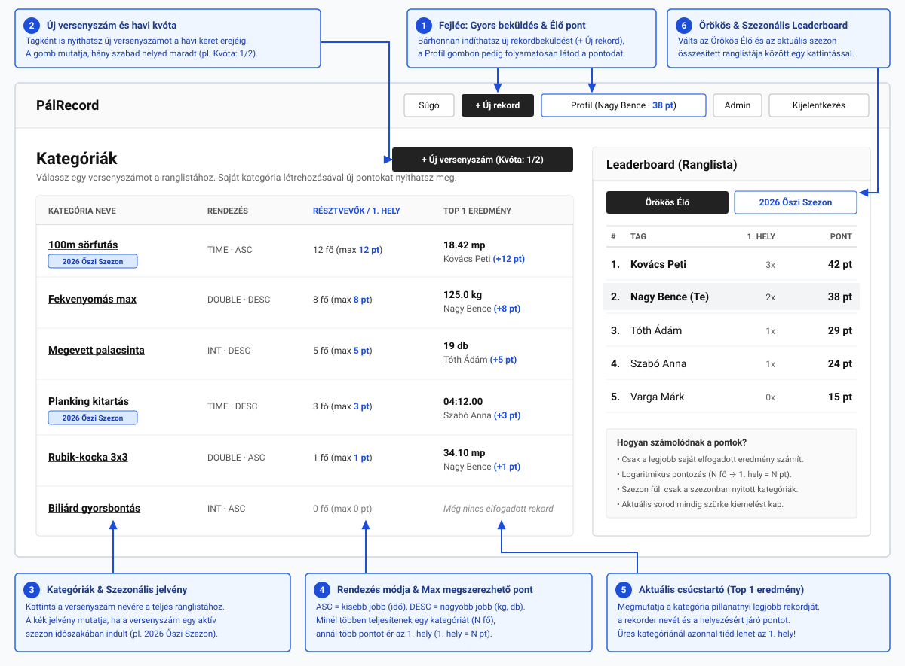
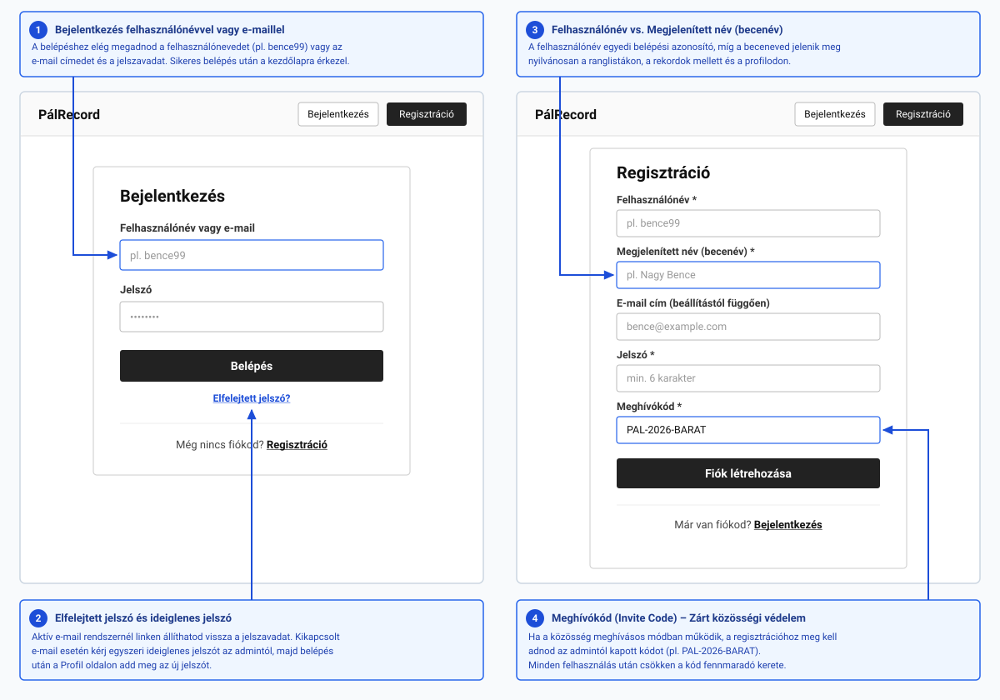
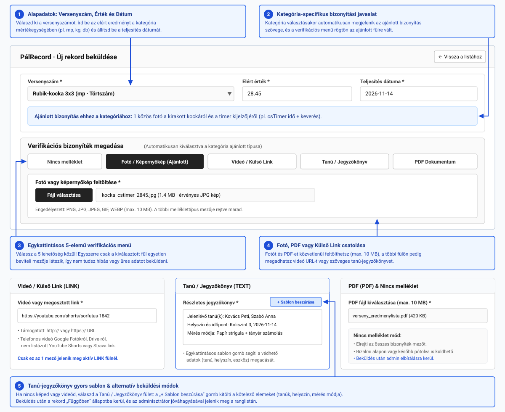
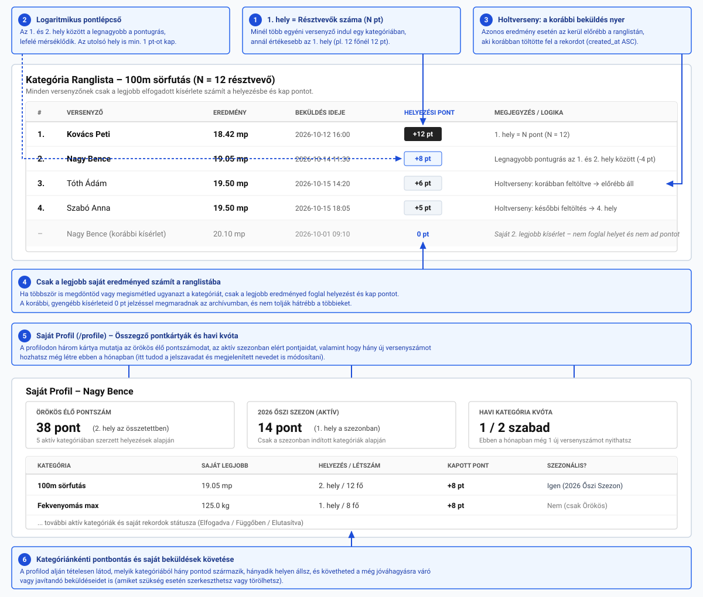

# PálRecord – Interaktív Vizuális Súgó (`/help`) Specifikáció

Ez a dokumentum a **PálRecord** alkalmazás új, nyilvánosan elérhető **Súgó (`/help`)** oldalának funkcionális, vizuális és technikai specifikációját rögzíti. A súgó célja, hogy az új és meglévő felhasználók számára közérthetően, a korábbi látványtervekből kiinduló, **nyilakkal és számozott szövegdobozokkal (calloutokkal)** ellátott SVG ábrák segítségével mutassa be a weboldal használatát.

Kapcsolódó dokumentumok:
- [Adatstruktúra specifikáció](../../Adatstruktúra/adatstruktura.md)
- [Alap látványtervek](../../Látványtervek/latvanyterv.md)
- [Pontrendszer specifikáció](../Pontrendszer/pontrendszer.md)
- [Verifikációs specifikáció](../Verifikáció/verifikacio.md)

---

## 1. Célkitűzés és alapelvek

1. **Nyilvános hozzáférhetőség (`/help`):** A Súgó oldal bejelentkezés nélkül (vendégként), bejelentkezett tagként/adminként, sőt kötelező jelszócsere (`must_change_password`) állapotban is azonnal megnyitható a fejlécben és a láblécben található **„Súgó”** gombra/linkre kattintva.
2. **Látványtervek közvetlen felhasználása:** A dokumentációban korábban elkészült képernyőtervek (`kezdolap.svg`, `login.svg`, `register.svg`, `verifikacios_menu_urlap.svg`, `kategoria_es_profil_pontok.svg`) képezik az alapját a súgó 4 annotált SVG ábrájának. A fejlesztői jelölések (`[ÚJ 1]`, `[ÚJ UI]`) helyett felhasználóbarát **mutató nyilak (`<marker>` nyílhegyek) és számozott szövegdobozok** magyarázzák el az egyes felületi elemek szerepét.
3. **Élő rendszerbeállítások tükrözése:** A Súgó szöveges áttekintője kiolvassa az aktuális `Setting` rekordokat (`monthly_category_limit`, `require_invite_code`, `require_record_approval`, `email_system`, `members_can_create_categories`), így a felhasználók mindig a ténylegesen aktív szabályokat látják.
4. **Minimalista, reszponzív kialakítás:** Külső CSS/JS keretrendszer nélkül, az alkalmazás meglévő stílusrendszerét (`application.css`) követve jelenik meg; az SVG ábrák alatt minden pont szöveges magyarázatként is olvasható mobilnézetben.

---

## 2. A Súgó oldal felépítése (5 fő szekció + gyorsnavigáció)

A `/help` oldal tetején gyors ugrólinkeket tartalmazó **tartalomjegyzék sáv** található az alábbi horgonyokkal:

- `#attekintes` – `1. Gyors áttekintés (4 lépés a rekordig)`
- `#kezdolap` – `2. Kezdőlap és Ranglisták`
- `#fiok` – `3. Belépés és Regisztráció`
- `#rekord-bekuldes` – `4. Rekord beküldése és Bizonyítás`
- `#pontozas-profil` – `5. Pontszámítás és Profil`

### 2.1. Gyors áttekintés (`#attekintes`)

4 lépéses kártyasor mutatja be a teljes használati folyamatot:
1. **Regisztráció és belépés:** Fiók létrehozása (meghívókóddal, ha az admin bekapcsolta) és belépés felhasználónévvel vagy e-mail-címmel.
2. **Versenyszám választása vagy nyitása:** Meglévő kategória kiválasztása, vagy saját versenyszám létrehozása az aktív havi kvóta terhére.
3. **Rekord beküldése bizonyítékkal:** Elért eredmény és dátum megadása, majd a 5-elemű menüből megfelelő igazolás (fotó, videó link, tanú-jegyzőkönyv vagy PDF) csatolása.
4. **Jóváhagyás és pontszerzés:** Adminisztrátori elbírálás után (ha a jóváhagyás aktív) a rekord megjelenik a ranglistán, és logaritmikus helyezési pontot ér.

Az áttekintő alatt egy **Aktuális rendszerbeállítások** tájékoztató sáv foglalja össze az élő szabályokat (`Setting` értékekből).

---

### 2.2. Kezdőlap, Kategóriák és Leaderboard (`#kezdolap`)

Alapja a `docs/Látványtervek/kezdolap.svg` látványterv. A nyilakkal és szövegdobozokkal jelölt elemek:
- **`[1]` Fejléc és élő összpontszám:** Bárhonnan elindítható az `+ Új rekord` beküldése, a `Profil` gombon pedig élőben látható az aktuális összpontszám (`pt`).
- **`[2]` Havi kategóriakeret:** Tagoknál a `+ Új versenyszám (Kvóta: X/Y)` gomb jelzi, hány új kategória indítható az adott hónapban.
- **`[3]` Kategóriák és szezonális jelvény:** A versenyszám nevére kattintva megnyílik a részletes ranglista; a kék jelvény az aktuális szezont jelöli.
- **`[4]` Rendezés és 1. hely max pont:** Az `ASC` (kisebb jobb, pl. idő) és `DESC` (nagyobb jobb, pl. kg/db) mellett látszik a résztvevők száma (`N fő`) és az 1. helyért járó pont (`max N pt`).
- **`[5]` Aktuális csúcstartó (Top 1):** Az adott versenyszám legjobb jóváhagyott eredménye, tulajdonosa és a helyezésért járó pontszám.
- **`[6]` Örökös és Szezonális Leaderboard:** A jobb oldali oldalsávban váltható az `Örökös Élő` és az aktuális szezonok közötti összesített ranglista; a bejelentkezett felhasználó sora kiemelve jelenik meg.

---

### 2.3. Bejelentkezés és Regisztráció (`#fiok`)

Alapja a `docs/Látványtervek/login.svg` és `docs/Látványtervek/register.svg` látványtervek kombinációja. Jelölt elemek:
- **`[1]` Rugalmas bejelentkezés:** A belépéshez felhasználónév és e-mail-cím egyaránt használható.
- **`[2]` Elfelejtett jelszó:** Aktív e-mail rendszer esetén önkiszolgáló visszaállítás kérhető; kikapcsolt e-mail rendszernél az adminisztrátor adhat ki egyszer használatos ideiglenes jelszót.
- **`[3]` Felhasználónév és becenév:** A felhasználónév az azonosítást szolgálja, míg a `Megjelenített név (becenév)` jelenik meg minden nyilvános ranglistán.
- **`[4]` Meghívókód (`Invite Code`):** Zárt közösségi védelem – ha a beállítás aktív, az admintól kapott érvényes kód megadása kötelező a regisztrációhoz.

---

### 2.4. Új rekord beküldése és Verifikáció (`#rekord-bekuldes`)

Alapja a `docs/Új Funkciók/Verifikáció/verifikacios_menu_urlap.svg` látványterv. Jelölt elemek:
- **`[1]` Alapadatok megadása:** Versenyszám kiválasztása, az elért eredmény beírása a kategória mértékegységében (`mp`, `kg`, `db`, stb.) és a teljesítés dátuma.
- **`[2]` Kategória-specifikus bizonyítási javaslat:** Kategória választásakor automatikusan megjelenik az elvárt bizonyítás leírása, és a menü az ajánlott fülre áll.
- **`[3]` 5-elemű verifikációs menü:** Egykattintásos választósáv (`Nincs melléklet`, `Fotó / Képernyőkép`, `Videó / Külső Link`, `Tanú / Jegyzőkönyv`, `PDF Dokumentum`). Egyszerre mindig csak az aktív fül egyetlen beviteli mezője látszik.
- **`[4]` Fájlfeltöltés és videó linkek:** Fotó vagy PDF közvetlenül feltölthető (`max. 10 MB`), míg videós bizonyíték megosztható külső URL-lel (`YouTube Shorts`, `Google Fotók`, `Drive`, `Strava`).
- **`[5]` Tanú-jegyzőkönyv gyors sablon:** A `+ Sablon beszúrása` gomb előre formázott mezőket szúr be a jelenlévő tanúk, a helyszín/időpont és a mérési eszköz rögzítéséhez.

---

### 2.5. Kategória Ranglista, Pontszámítás és Saját Profil (`#pontozas-profil`)

Alapja a `docs/Új Funkciók/Pontrendszer/kategoria_es_profil_pontok.svg` látványterv. Jelölt elemek:
- **`[1]` Helyezési pont (`1. hely = N pt`):** Minden kategóriában a győztes pontszáma megegyezik a jóváhagyott eredményt elérő egyéni versenyzők számával (`N`).
- **`[2]` Logaritmikus pontlépcső:** A pontok az 1. helytől lefelé logaritmikusan csökkennek (az élmezőnyben a legnagyobb a különbség), az utolsó helyezett mindig minimum `1 pt`-ot kap.
- **`[3]` Holtverseny-feloldás:** Azonos eredménynél az áll előrébb a ranglistán, aki korábban küldte be a rekordját (`created_at ASC`).
- **`[4]` Csak a legjobb saját rekord számít:** Minden versenyzőnek kizárólag a legjobb jóváhagyott eredménye szerez pontot és foglal helyezést; a gyengébb kísérletek `0 pt` jelzéssel maradnak láthatók.
- **`[5]` Saját Profil összegző kártyák:** A `/profile` oldalon áttekinthető az örökös élő összpontszám, az aktív szezonális pontszám és a havi kategóriakvóta állapota.
- **`[6]` Kategóriánkénti pontbontás:** Tételes táblázat mutatja minden aktív kategóriában a saját legjobb eredményt, a helyezést, a szerzett pontot és a szezonhoz tartozást.

---

## 3. Technikai megvalósítás és érintett fájlok

- **Útvonal (`config/routes.rb`):** `get "/help", to: "help#show", as: :help`
- **Controller (`app/controllers/help_controller.rb`):** Autentikáció nélkül elérhető `HelpController#show` akció, amely betölti az élő `Setting` értékeket a szöveges tájékoztatóhoz.
- **Globális jelszócsere-kivétel (`app/controllers/application_controller.rb`):** Az `enforce_password_change` szűrőben a `help` controller engedélyezett, így ideiglenes jelszóval belépett felhasználó is elolvashatja a súgót.
- **Navigáció (`app/views/layouts/application.html.erb`):** A fejléc (`.header-nav`) minden állapotban tartalmazza a `Súgó` gombot (`btn btn-outline`), a lábléc pedig tartalmazza a `Használati útmutató (Súgó)` linket.
- **Nézet és stílus (`app/views/help/show.html.erb`, `app/assets/stylesheets/application.css`):** Minimalista, reszponzív HTML + CSS struktúra tartalomjegyzékkel, 4 lépéses áttekintővel, az SVG ábrák beágyazásával (`app/assets/images/help/*.svg`) és számozott jelmagyarázatokkal.
- **Tesztek (`test/integration/help_flow_test.rb`):** Ellenőrzi a `/help` oldal elérhetőségét vendégként (zárt `public_leaderboards: false` mellett is), bejelentkezett felhasználóként és ideiglenes jelszóval, valamint a navigációs linkek és a 4 SVG diagram renderelését.
