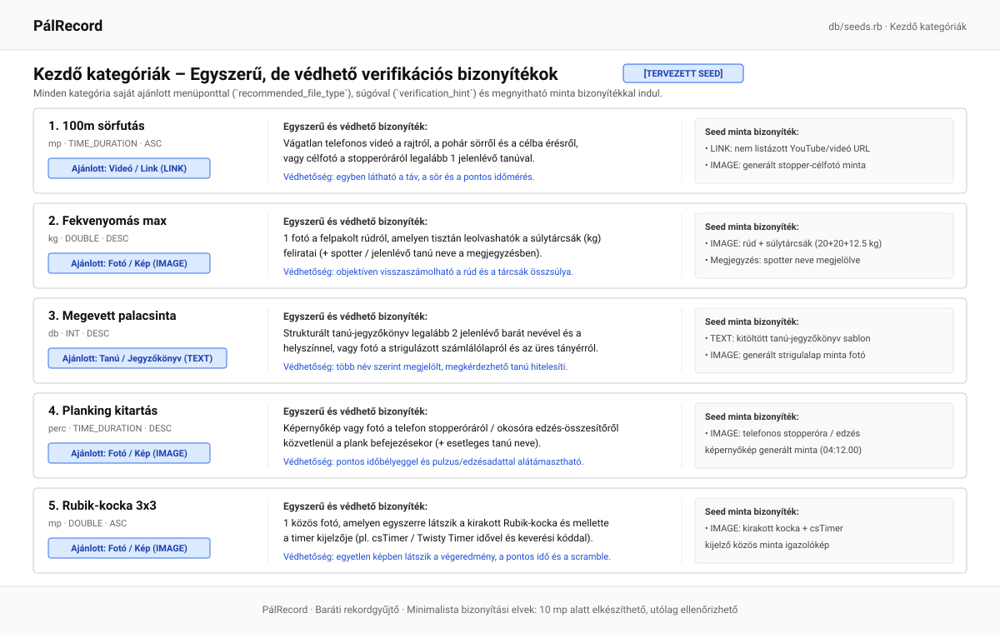
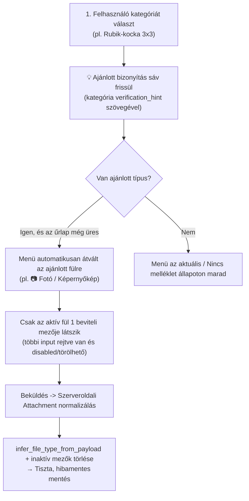
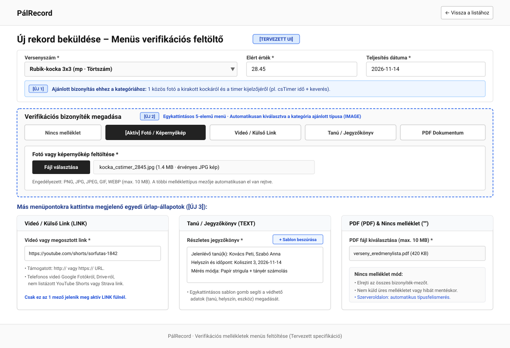
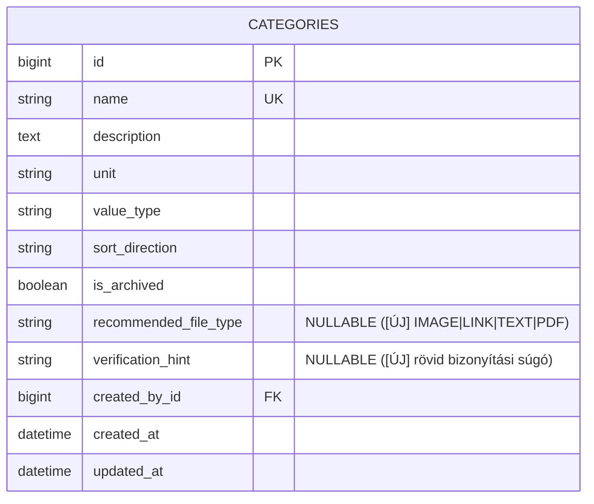

# PálRecord – Verifikációs Mellékletek és Bizonyítási Specifikáció

Ez a dokumentum a **PálRecord** alkalmazás rekord-verifikációs rendszerének egyszerűsített, menüs feltöltési felületét, valamint a kezdő kategóriákhoz tartozó, minimális erőfeszítéssel elkészíthető, mégis védhető bizonyítási szabályait és mintaadatait specifikálja.

Kapcsolódó dokumentumok:
- [Adatstruktúra specifikáció](../../Adatstruktúra/adatstruktura.md)
- [Alap látványtervek](../../Látványtervek/latvanyterv.md)
- [Pontrendszer specifikáció](../Pontrendszer/pontrendszer.md)

---

## 1. Célkitűzés és alapelvek

A jelenlegi `records/_form.html.erb` nézetben egyszerre jelenik meg egy technikai legördülő (`IMAGE / PDF / TEXT / LINK`), egy fájlfeltöltő, egy külső URL-mező és egy szövegdoboz. Ez hibalehetőséget és felesleges vizuális zajt okoz a felhasználónak, különösen mobilon, valamint a kategóriák sem adnak útmutatást arra, mit érdemes feltölteni.

Az új megoldás alapelvei:
1. **10 másodperces bizonyíthatóság:** Egy baráti társaságban a rekordok 90%-a telefonról rögzíthető – elég egy gyors fotó, képernyőkép, rövid videó link vagy két jelenlévő tanú megnevezése.
2. **Védhetőség manipuláció ellen:** Minden bizonyíték tartalmazzon objektíven visszakövethető elemet (mérőeszköz/időmérő/tárcsák együtt egy képen, vágatlan videó, vagy név szerint megjelölt tanúk és helyszín).
3. **Egykattintásos, menüs feltöltő (`verification-menu`):** Egyszerre **kizárólag az aktív menüponthoz tartozó egyetlen beviteli mező** látszik, és a kategória kiválasztásakor a rendszer automatikusan az ajánlott fülre áll.
4. **Hibabiztos szerveroldali kezelés:** Ha a felhasználó fájlt vagy linket ad meg, a backend képes automatikusan felismerni a típust, és eldobja a nem aktív fülekben maradt üres/félbehagyott inputokat.

---

## 2. Verifikációs bizonyítéktípusok és az 5-elemű menüs feltöltő

A rekordbeküldő (`records/new` és `records/edit`) melléklet-blokkja a jelenlegi 4+1 mezős ömlesztett elrendezés helyett egy **5-elemű vízszintes választómenüt (`verification-menu`)** használ:

| Menüpont | `Attachment.file_type` | Megjelenő egyetlen beviteli mező | Validáció / Elfogadott formátum | Tipikus használat |
| :--- | :---: | :--- | :--- | :--- |
| **🚫 Nincs melléklet** | `""` *(üres)* | Egyik beviteli mező sem látszik | Nem jön létre `Attachment` rekord | Bizalmi alapon beküldött, vagy később pótolt rekord |
| **📷 Fotó / Képernyőkép** | `IMAGE` | Fájlfeltöltő mező (`accept="image/*"`) | `.png`, `.jpg`, `.jpeg`, `.gif`, `.webp`, max. `10 MB` | Stopperóra, súlytárcsák, kirakott kocka + timer, számlálólap |
| **🎬 Videó / Külső Link** | `LINK` | Külső URL beviteli mező (`https://...`) | Érvényes `http://` vagy `https://` URL | Vágatlan telefonos videó (Google Fotók, Drive, YouTube Shorts, Strava) |
| **🤝 Tanú / Jegyzőkönyv** | `TEXT` | Szövegdoboz + **„+ Sablon beszúrása”** gomb | Nem üres szöveges tartalom | Baráti összejövetelen felvett jegyzőkönyv tanúkkal és helyszínnel |
| **📄 PDF Dokumentum** | `PDF` | PDF fájlfeltöltő (`accept="application/pdf"`) | `.pdf` kiterjesztés, max. `10 MB` | Hivatalos versenyeredmény-lista, oklevél, mérési jegyzőkönyv |

### 2.1. Tanú / Jegyzőkönyv gyors sablon (`TEXT`)
A **„+ Sablon beszúrása”** gomb egy kattintással az alábbi szerkezetet tölti be a jegyzőkönyv-mezőbe (ha az még üres, vagy a végére fűzi):

```text
Jelenlévő tanú(k): 
Helyszín és időpont: 
Mérés módja / eszköz: 
```

Ez minimális gépeléssel biztosítja, hogy az adminisztrátor számára utólag is ellenőrizhetőek legyenek a körülmények.

---

## 3. Kezdő kategóriák (`db/seeds.rb`) bizonyítási szabályai és mintaadatai

Mind az 5 alapértelmezett kategória megkapja az ajánlott menüpontját (`recommended_file_type`), a kategóriaoldalon és a beküldő űrlapon is megjelenő útmutatóját (`verification_hint`), valamint a `db/seeds.rb` létrehoz hozzájuk **valódi, a felületen megnyitható minta rekordokat és bizonyítékokat** (`storage/uploads` képmintákkal, URL-ekkel és jegyzőkönyvvel).



| # | Kezdő kategória | Mértékegység / Rendezés | Ajánlott menü (`recommended_file_type`) | `verification_hint` (Kategóriaszintű bizonyítási elvárás) | Miért egyszerű, mégis védhető? | `db/seeds.rb` minta bizonyítékok |
| :-: | :--- | :---: | :---: | :--- | :--- | :--- |
| **1** | **100m sörfutás** | `mp` (`TIME_DURATION · ASC`) | `LINK` *(vagy `IMAGE`)* | *„Vágatlan telefonos videó a rajtról, a pohár sörről és a célba érésről (Google Fotók / YouTube Shorts link), vagy célfotó a stopperről + tanú.”* | A videón egyben látható a teljes táv, a sör megléte és a pontos célba érés; megosztása mobilon 1 linkmásolás. | Minta nem listázott videó `LINK` + generált stopper-célfotó `IMAGE` |
| **2** | **Fekvenyomás max** | `kg` (`DOUBLE · DESC`) | `IMAGE` | *„1 fotó a felpakolt rúdról, amelyen tisztán leolvashatók a súlytárcsák (kg) feliratai, valamint a spotter/tanú neve a megjegyzésben.”* | Nem kell edzés közben videót állítani, elég az emelés után 1 fotó a tárcsákról + a spotter neve. | Generált súlytárcsás rúd igazolókép (`IMAGE`: `20+20+12.5 kg`) + spotter megjegyzés |
| **3** | **Legtöbb megevett palacsinta** | `db` (`INT · DESC`) | `TEXT` *(vagy `IMAGE`)* | *„Tanú-jegyzőkönyv legalább 2 jelenlévő barát nevével és a helyszínnel, vagy fotó a strigulázott számlálólapról és az üres tányérról.”* | Közösségi evőversenynél a jelenlévők neve és a strigulázott lap a legkönnyebben visszakérdezhető bizonyíték. | Kitöltött `TEXT` tanú-jegyzőkönyv (2 tanúval) + generált strigulalap `IMAGE` minta |
| **4** | **Planking kitartás** | `perc` (`TIME_DURATION · DESC`) | `IMAGE` | *„Fotó vagy képernyőkép a telefon stopperóráról / okosóra edzés-összesítőről közvetlenül a plank befejezésekor (+ tanú neve).”* | Egyetlen képernyőképpel igazolható az időtartam és az okosóra/telefon időbélyege. | Generált stopperóra képernyőkép (`IMAGE`: `04:12.00`) |
| **5** | **Rubik-kocka 3x3** | `mp` (`DOUBLE · ASC`) | `IMAGE` | *„1 közös fotó, amelyen egyszerre látszik a kirakott Rubik-kocka és mellette a timer kijelzője (pl. csTimer / Twisty Timer idővel és keveréssel).”* | A kirakott kocka és a timer közös lefotózása kizárja a puszta számbeírást és megmutatja a keverési kódot is. | Generált „kirakott Rubik-kocka + csTimer” közös igazolókép (`IMAGE`) |

---

## 4. Dinamikus űrlap-működés és szerveroldali logika



### 4.1. Kategória metaadatok beküldéskor (`categories/_form` és `categories/show`)
- **Kategória létrehozása / szerkesztése (`categories/_form.html.erb`):**
  - Új opcionális mező: **Ajánlott bizonyítási mód (`recommended_file_type`)** legördülő (`-- Nincs kiemelt ajánlás --`, `📷 Fotó / Képernyőkép (IMAGE)`, `🎬 Videó / Link (LINK)`, `🤝 Tanú / Jegyzőkönyv (TEXT)`, `📄 PDF Dokumentum (PDF)`).
  - Új opcionális mező: **Bizonyítási elvárás / tipp (`verification_hint`)** szövegmező (max. 255 karakter).
- **Kategória adatlap (`categories/show.html.erb`):**
  - A „Szabályzat / leírás” dobozban jól láthatóan megjelenik az **`Ajánlott bizonyítás:`** sor (típusjelvénnyel és a tippel).
- **Ranglista és Admin elbírálás (`categories/show`, `admin/records/index`):**
  - A mellékletek mellett megjelenik az olvasható magyar típusjelvény (`📷 Fotó`, `🎬 Videó/Link`, `🤝 Jegyzőkönyv`, `📄 PDF`), hogy az elbírálás gyorsan áttekinthető legyen.

### 4.2. Okos szerveroldali feldolgozás (`Attachment`)
- **`infer_file_type_from_payload` (előfeldolgozás validáció előtt):**
  - Ha a kliens küld egy feltöltött fájlt (`uploaded_file`), de a `file_type` üresen maradt, a kiterjesztés alapján automatikusan `.pdf` -> `"PDF"`, képek (`.png/.jpg/.jpeg/.gif/.webp`) -> `"IMAGE"` típusra állítja.
  - Ha `file_path_or_url` érkezett `uploaded_file` nélkül és `file_type` üres, `"LINK"` típusra állítja.
  - Ha `text_content` érkezett fájl/URL nélkül és `file_type` üres, `"TEXT"` típusra állítja.
- **Inaktív mezők tisztítása mentéskor:**
  - Ha `file_type == "IMAGE"` vagy `"PDF"`, a `text_content` figyelmen kívül marad (`nil`).
  - Ha `file_type == "LINK"`, a `text_content` és `uploaded_file` nem zavar be.
  - Ha `file_type == "TEXT"`, a `file_path_or_url` és `uploaded_file` törlődik mentés előtt.

---

## 5. Vizuális látványterv – Menüs feltöltő az űrlapon



**A képernyő fő elemei:**
1. **`[ÚJ 1]` Kategória bizonyítási ajánló sáv:** Közvetlenül a versenyszám/érték/dátum sor alatt jelenik meg, JSON/HTML data-attribútumokból dinamikusan frissül kategória-váltáskor.
2. **`[ÚJ 2]` 5-elemű verifikációs menü (`verification-menu`):** Egyszerű, minimalista CSS gombsor (`1px solid #cccccc`, aktív gomb `#222222` háttérrel és fehér szöveggel – összhangban a többi oldal stílusával).
3. **`[ÚJ 3]` Állapotonként egyetlen tiszta beviteli mező:** Mindig csak a választott bizonyíték-típus mezője jelenik meg, a `Tanú / Jegyzőkönyv` fülön a **„+ Sablon beszúrása”** segédgombbal.

---

## 6. Adatbázis- és Architektúra-kiegészítések

### 6.1. `categories` tábla bővítése (`db/migrate/20261114180001_add_verification_fields_to_categories.rb`)



| Új oszlop (`categories`) | MySQL típus | Kötelező? | Alapértelmezett | Megjegyzés |
| :--- | :--- | :---: | :---: | :--- |
| `recommended_file_type` | `VARCHAR(20)` | Nem | `NULL` | `Attachment::FILE_TYPES` (`'IMAGE'`, `'LINK'`, `'TEXT'`, `'PDF'`) – melyik menüfület ajánlja az űrlap. |
| `verification_hint` | `VARCHAR(255)` | Nem | `NULL` | A kategóriánál megjelenő rövid bizonyítási útmutató (pl. *„1 fotó a súlytárcsákról…”*). |

### 6.2. Érintett fájlok megvalósításkor
- **Migráció & Modellek:** új migráció (`add_verification_fields_to_categories`), `app/models/category.rb`, `app/models/attachment.rb`, `app/controllers/categories_controller.rb`.
- **Nézetek & Stílus:** `app/views/records/_form.html.erb`, `app/views/categories/_form.html.erb`, `app/views/categories/show.html.erb`, `app/views/admin/records/index.html.erb`, `app/helpers/application_helper.rb`, `app/assets/stylesheets/application.css`.
- **Seed & Tesztek:** `db/seeds.rb` (minta képek és rekordok mind az 5 kezdő kategóriához), `test/models/attachment_test.rb`, `test/integration/email_system_and_attachments_flow_test.rb`.
